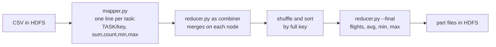

# Flight price analysis with Hadoop MapReduce

A Hadoop Streaming job in Python that reads flight price data from HDFS and reports, per airline, route, month, date and weekday, the number of flights and the average, minimum and maximum price. I rebuilt it from my M.Sc. Data Analytics coursework (Big Data Analytics, BSBI, 2024).

The original job ran, but two bugs made most of its output wrong or empty. The rebuild fixes them, adds a combiner, and comes with a local runner that does the same steps as Hadoop so the job can be tested without a cluster. Details: [docs/coursework-review.md](docs/coursework-review.md).

## How the job works



* The key is `TASK|name` (for example `AIRLINE|IndiGo`), so Hadoop sorts and partitions on the full key.
* Every value has the same shape: sum, count, min, max. These can be merged in any order, so one script works as both combiner and reducer, and the result is the same for any number of mappers and reducers.
* Rows with a missing or non-numeric price are skipped and counted with Hadoop counters (`good_row`, `bad_row`, `bad_date`), so they show in the job summary.

## Results

From the 1,038,803-row flight file used in the coursework. The file holds 39% exact duplicate rows, so results are given both ways: [results/output_all_rows.tsv](results/output_all_rows.tsv) and [results/output_deduplicated.tsv](results/output_deduplicated.tsv).

Average price per airline, duplicates removed (INR):

| Airline | Flights | Average | Min | Max |
|---|---|---|---|---|
| Jet Airways | 223,411 | 10,819 | 1,759 | 79,512 |
| Multiple carriers | 77,142 | 10,028 | 1,759 | 54,826 |
| Air India | 110,692 | 9,740 | 1,759 | 79,512 |
| Vistara | 28,810 | 8,991 | 1,759 | 57,209 |
| IndiGo | 112,177 | 8,070 | 1,759 | 79,512 |
| GoAir | 12,454 | 8,003 | 1,759 | 31,825 |
| Air Asia | 19,627 | 7,482 | 1,840 | 62,427 |
| SpiceJet | 45,002 | 7,433 | 1,759 | 46,490 |

Busiest routes, all rows:

| Route | Flights | Average price |
|---|---|---|
| Delhi -> Cochin | 441,163 | 10,539 |
| Kolkata -> Banglore | 279,254 | 9,159 |
| Banglore -> Delhi | 122,959 | 5,144 |
| Banglore -> New Delhi | 90,616 | 11,922 |
| Mumbai -> Hyderabad | 67,827 | 5,060 |

Jet Airways costs a third more than IndiGo and nearly half more than SpiceJet. Prices by month and weekday are almost flat (9,072 to 9,109 by month). That says more about how the file was enlarged than about real demand, because the dates are spread nearly evenly over March to June 2019.

## Run it

Without Hadoop:

```bash
python scripts/make_sample.py data/sample.csv --rows 20000
python scripts/local_run.py data/sample.csv --mappers 4 --reducers 2 --out results/sample_output.tsv
# or the classic pipe test
python mapreduce/mapper.py < data/sample.csv | sort | python mapreduce/reducer.py --final
pytest
```

On a Hadoop cluster (setup steps in [docs/hadoop-setup.md](docs/hadoop-setup.md)):

```bash
python scripts/make_sample.py data/big.csv --megabytes 1100   # a 1 GB+ test file
bash scripts/run_hadoop.sh data/big.csv
```

## Data

The coursework file was based on the Kaggle data set *Flight Price Prediction* (Indian domestic flights, 2019). It is not included here. The job reads any CSV with the columns `Airline`, `Date_of_Journey`, `Source`, `Destination` and `Price`. `scripts/make_sample.py` writes a file with the same columns at any size, for tests and for loading HDFS.

## Layout

```
mapreduce/mapper.py     mapper
mapreduce/reducer.py    combiner and reducer
scripts/local_run.py    map, combine, partition, sort, reduce without Hadoop
scripts/run_hadoop.sh   upload to HDFS and run on YARN
scripts/make_sample.py  test data at any size
original/               the coursework mapper and reducer, unchanged
results/                output on the coursework file
docs/                   Hadoop setup, coursework review
tests/                  6 tests, including two that show the original bugs
```

## License

MIT
